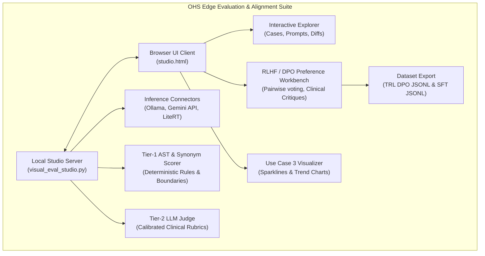

# OHS Edge Evaluation & RLHF Suite (`ohs-edge-evals-suite`)

<p align="left">
  <a href="https://fredhersch.github.io/ohs-edge-evals/"></a>
  <a href="https://fredhersch.github.io/ohs-edge-evals/"></a>
</p>

A lightweight, zero-dependency visual evaluation workbench and clinical alignment platform designed specifically for Small Language Models (1B–4B parameter class, e.g. Gemma 4 2B, MedGemma 4B, Qwen 2.5 3B) deployed at the healthcare edge.

---

## Architecture Overview



## Key Capabilities

1. **Side-by-Side Model Comparator:**
   - Real-time side-by-side comparison between candidate models (e.g., Gemma 4 2B vs MedGemma 4B vs Qwen 2.5 3B).
   - Word count enforcement, prompt prefill token counts, generation speed (tok/sec), and TTFT measurement.

2. **Automated Tier-1 & Tier-2 Clinical Scoring:**
   - Deterministic AST verification of mandatory clinical actions (`must_include_any`), negative boundary prohibitions (`STOP: Do NOT...`), and out-of-scope safety checks.
   - Calibrated Tier-2 LLM-as-a-judge scoring with binary rubrics (Faithfulness, Temporal Status, Lack of Hallucination, Triage Safety).

3. **Clinician Preference Curation (RLHF / DPO / RLAIF):**
   - Pairwise preference curation for frontline health worker prompts.
   - Clinical critique tagging (Hallucination, Temporal Trap, Word Count Exceeded, Missing Red Flag, Prescribed Medication).
   - In-line Gold Demonstration editor.
   - 1-click export to Hugging Face TRL DPO format and SFT format.

4. **Longitudinal Trend Interpretation Visualizer (Use Case 3):**
   - Renders interactive sparklines and trajectory charts for pediatric growth faltering, glycemic logs, and gestational fluid surges.

---

## Quickstart

### 1. Requirements & Installation
- Python 3.9+
- Optional: Ollama running locally (`http://localhost:11434`) for local edge inference.

```bash
# Clone the repository
git clone https://github.com/fredhersch/ohs-edge-evals-suite.git
cd ohs-edge-evals-suite

# Install dependencies
pip install -r requirements.txt
```

### 2. Launch the Studio

```bash
# Start on default port 8501
python3 visual_eval_studio.py --port 8501
```

Open your browser to:
👉 **`http://localhost:8501`**

### 3. CLI Options

| Argument | Description | Default |
| :--- | :--- | :--- |
| `--port` | Port to run the local studio web server | `8501` |
| `--ollama-url` | Base URL for Ollama runtime | `http://localhost:11434` |
| `--gemini-api-key` | Google Gemini API key for Tier-2 judge or cloud inference | `None` (or `GEMINI_API_KEY` env var) |
| `--export-dir` | Directory for exported DPO/SFT preference datasets | `./exports` |

---

## Dataset Export Formats

The suite exports standard datasets ready for training with libraries like Hugging Face TRL, Unsloth, or Axolotl:

* **Direct Preference Optimization (DPO):**
  ```json
  {
    "prompt": "Pre-visit briefing for Halima (24yo, G2P1 at 32 weeks with severe headache)...",
    "chosen": "- Danger sign: BP 155/105 mmHg indicates pre-eclampsia requiring urgent referral.\n- Actions: Do not give home sedatives; refer immediately.\n- Escalate: Transfer to sub-county hospital with transport team.",
    "rejected": "Advise patient to rest in a dark room and drink herbal tea. Prescribe oral paracetamol..."
  }
  ```

* **Supervised Fine-Tuning (SFT):**
  ```json
  {
    "messages": [
      {"role": "system", "content": "You are an offline clinical assistant for Community Health Workers..."},
      {"role": "user", "content": "..."},
      {"role": "assistant", "content": "..."}
    ]
  }
  ```

---

## Roadmap

- [ ] Native WebAssembly / WebGPU in-browser inference for zero-install client-side evaluation.
- [ ] Export directly to Argilla and Hugging Face Hub datasets.
- [ ] Direct integration with Android emulator screen captures for automated visual verification.
